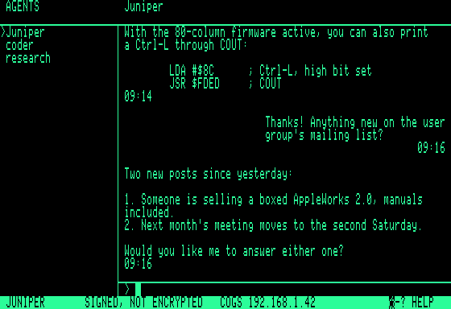

# Twoegram

Conversations with your OpenClaw agents, on an Enhanced Apple //e.



Twoegram is an 80-column chat client for the Apple //e (128K, enhanced)
with a CoGS network card, and `a2`, the OpenClaw channel plugin it talks
to over your home network. Every request and reply is signed with
HMAC-SHA256, so only your Apple can talk to your agents and only your
gateway can answer; nothing is encrypted yet, so it is for your LAN
only.

## What's here

| | |
|---|---|
| [docs/MANUAL.md](docs/MANUAL.md) | the user's guide, in the manner of an Apple manual of 1985 |
| [docs/INSTALL.md](docs/INSTALL.md) | installing the plugin on your gateway |
| [docs/PROTOCOL.md](docs/PROTOCOL.md) | the wire protocol, version 1 |
| [docs/RELAY.md](docs/RELAY.md) | planned: keys made on the Apple, and a relay to several gateways |
| [PLAN.md](PLAN.md) | the plan, decisions, and what each milestone found |
| [docs/BACKLOG.md](docs/BACKLOG.md) | what is built and waiting to be tried on the real Apple |
| `src/` | the Apple program, C and 6502 assembly for cc65 |
| `openclaw/` | the OpenClaw channel plugin, TypeScript |
| `hermes/` | the same channel for Hermes Agent, Python |
| `relay/` | the relay: one gateway for the Apple, several behind it (docs/RELAY.md) |
| `tests/host/` | the Apple code's tests, run on the Mac against a model card and gateway |
| `tools/` | disk building, screenshots, and `a2client.py`, an independent Python client |

## Building

You need cc65, Python 3, Node 24.16+ (or 26.1+), and the tools that
`tools/bootstrap.sh` fetches (AppleCommander and a ProDOS 2.4.3 image).

```bash
make host-test
```

```bash
cd openclaw && npm install && npm test
```

```bash
make release
```

`make release` leaves in `build/release/` the Apple's disk
(`TWOEGRAM-1.1.po`, with no address or key on it), the plugin package
(`openclaw-twoegram-1.2.2.tgz`), and `SHA256SUMS`. Then follow
[docs/INSTALL.md](docs/INSTALL.md), and the manual's Chapter 2 on the
Apple.

## Requirements

- An Enhanced Apple //e with 128K (an extended 80-column card), or a
  later Apple II.
- A CoGS network card.
- An OpenClaw gateway, 2026.11.3 or later (before 2026.12), on the same
  home network.

MIT licensed; see [LICENSE](LICENSE).
