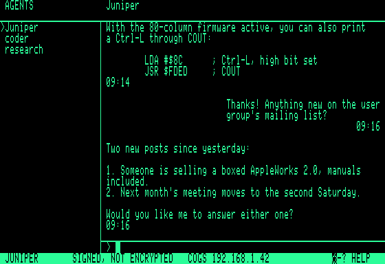
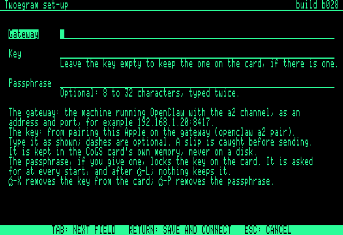
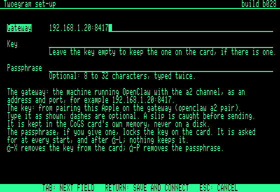
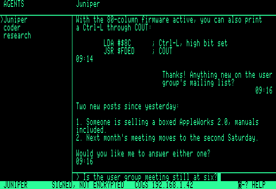
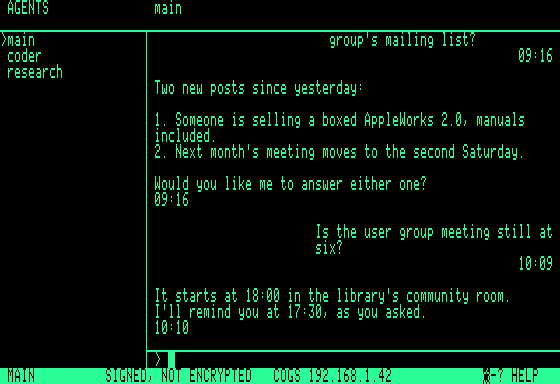
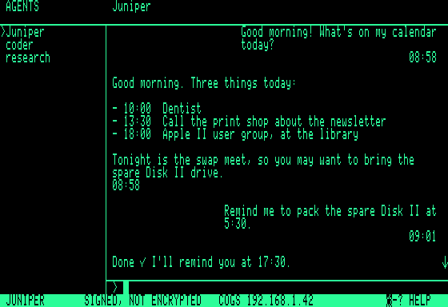
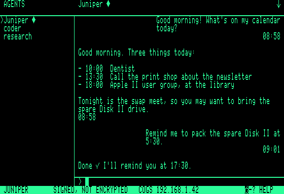
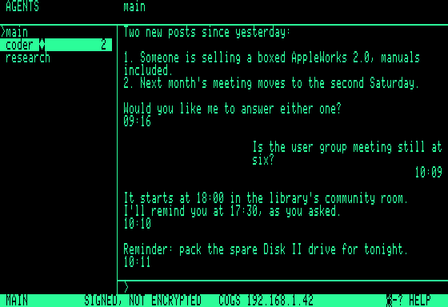

# Twoegram

### Conversations with Your Agents, for the Apple IIe

#### User's Guide · Version 1.0


---

## Contents

- [About This Guide](#about-this-guide)
- [Chapter 1: Getting Started](#chapter-1-getting-started)
- [Chapter 2: Setting Up Twoegram](#chapter-2-setting-up-twoegram)
- [Chapter 3: Having a Conversation](#chapter-3-having-a-conversation)
- [Chapter 4: Looking Back](#chapter-4-looking-back)
- [Chapter 5: More Than One Agent](#chapter-5-more-than-one-agent)
- [Chapter 6: Keeping Your Conversations Private](#chapter-6-keeping-your-conversations-private)
- [Appendix A: Quick Reference](#appendix-a-quick-reference)
- [Appendix B: Messages](#appendix-b-messages)
- [Appendix C: For the Technically Curious](#appendix-c-for-the-technically-curious)
- [Appendix D: Twoegram's Limits](#appendix-d-twoegrams-limits)

---

## About This Guide

Welcome to Twoegram. With Twoegram and a CoGS card, your Apple IIe can
hold a conversation with your **agents**: the helpers that live on your
OpenClaw gateway and keep your calendar, answer your questions, write
programs and look things up. You type at the Apple's keyboard, and their
answers appear on your 80-column screen.

This guide shows you how. You don't need to know how the agents work,
or how the network carries your words. If you can put a disk in a drive
and type a sentence, you can talk with your agents.

**Chapter 1** tells you what you need and how to start Twoegram.
**Chapter 2** shows how to introduce your Apple to your gateway, which
you do only once. **Chapter 3** takes you through a conversation: typing,
sending, and reading the answer. **Chapter 4** shows how to look back
through what was said. **Chapter 5** explains how to move between
agents, and how Twoegram tells you when one of them has something new.
**Chapter 6** explains how Twoegram keeps strangers out of your
conversations, and what it can't yet protect. At the back of the guide
you'll find a one-page summary of the keys, a list of the messages
Twoegram can show you, some notes for people who want to know how it all
works, and a list of Twoegram's limits.

### What Is an Agent?

An **agent** is a helper program that runs on your **gateway**: a modern
computer on your home network, running a program called OpenClaw. Each
agent has a name, such as `Juniper` or `coder`, and its own way of
working: one may look after your day, another may help you write
software.

Twoegram doesn't think for itself. It carries your words to the gateway,
and brings the agent's answer back to your Apple.

### Conventions Used in This Guide

Keys you press are shown in capital letters: RETURN, ESC, TAB, DELETE.
The arrow keys are called UP ARROW and DOWN ARROW.

When you see **OPEN-APPLE-Q**, hold down the OPEN-APPLE key (the key
with the outline of an apple, to the left of the space bar) and press Q.
Then let go of both keys.

Things you type are shown like `this`.

> **Important:** Paragraphs like this one contain information you need
> to know to avoid a problem.

> **By the way:** Paragraphs like this one contain extra information
> that's interesting, but not essential.

---

## Chapter 1: Getting Started

### What You Need

To use Twoegram, you need

- an **Apple IIe** with **128K** of memory and an **80-column text
  card**. (The enhanced Apple IIe is best: it shows Twoegram's special
  symbols. An unenhanced Apple IIe works too, with plain letters in
  their place.)
- a **CoGS card** installed in any slot, and connected to your home
  network.
- the **Twoegram disk**: on a floppy disk, a hard disk, or the CoGS
  card's own network disk.
- an **OpenClaw gateway** on the same home network, with Twoegram's
  channel installed. Whoever looks after your gateway can set this up in
  a few minutes; the instructions come with Twoegram, in the file
  `docs/INSTALL.md`.

> **Important:** Set up the CoGS card's network connection before you
> start Twoegram, using the card's own configuration screen. The CoGS
> card's manual tells you how. Twoegram uses the connection; it doesn't
> set it up.

### Starting Twoegram

1. Put the Twoegram disk in the startup drive, or choose it on your CoGS
   card.
2. Turn on the computer, or press CONTROL-OPEN-APPLE-RESET if it's
   already on.

The title screen appears (you saw it on the cover of this guide). The
build number under the title tells you exactly which copy of Twoegram
you have; mention it if you ever report a problem.

3. Press any key to continue.

The first time you start Twoegram, the **Set-up screen** appears next.
Chapter 2 tells you what to type there. After that, Twoegram remembers,
and takes you straight to your conversation.

### The Status Bar

The bright bar along the bottom of the screen is the **status bar**. It
tells you where you are and what Twoegram is doing.



**Figure 1-1.** The conversation screen. The status bar is the bright
line at the foot.

From left to right, it shows the agent you're talking with, how your
conversation is protected (`SIGNED, NOT ENCRYPTED`; see Chapter 6), the
CoGS card's address on your network, and a reminder that OPEN-APPLE-?
brings help.

When Twoegram has something to tell you, such as `SENDING` or
`FETCHING OLDER MESSAGES`, its message takes over the status bar until
you press the next key.

If the gateway stops answering, perhaps because it is being restarted,
the middle of the status bar says `GATEWAY NOT ANSWERING` (or
`NO NETWORK`, or `GATEWAY BUSY`) in place of `SIGNED, NOT ENCRYPTED`.
Your conversation stays on the screen, and Twoegram keeps trying by
itself: after 5 seconds, then less and less often, but at least once a
minute. When the gateway answers again, the status bar goes back to
normal. You don't need to do anything.

> **By the way:** The pictures in this guide were made on a modern
> computer, because the Apple IIe simulator used for them has no CoGS
> card. The pictures of a conversation were drawn by Twoegram's own
> screen program, using the Apple IIe's own characters, so they look
> exactly as your screen will. The conversation in them is made up, and
> the addresses are examples; yours will be different.

### Getting Help

Whenever you need a reminder, press **OPEN-APPLE-?**. A box appears with
every key that Twoegram understands, and what the two little symbols in
the heading mean (Chapters 4 and 5 explain them). Press any key to make
it go away.


**Figure 1-2.** The help box. This picture was taken without a CoGS
card, so the status bar below it says so.

### Quitting

To stop using Twoegram, press **OPEN-APPLE-Q**. Twoegram returns you to
ProDOS. Your conversations aren't lost: they're kept on the gateway, and
appear again the next time you start Twoegram.

---

## Chapter 2: Setting Up Twoegram

Before your Apple can talk with your agents, the gateway has to know
it. You introduce them once, with a **key**: a secret password, made by
the gateway for your Apple alone. After that, Twoegram remembers the
gateway and the key, and connects by itself each time you start it.

### Getting a Key from the Gateway

The key is made on the gateway. Whoever looks after the gateway types
this command there:

```
openclaw a2 pair "Apple IIe"
```

The gateway answers with two things for you to copy down:

- the **key**: 27 letters and numbers, in groups of five, such as
  `00000-00000-00000-00000-00000-00`. (That one is only an example.)
- the **gateway's address**, such as `http://192.168.1.20:8417`.

> **Important:** The key is shown only once. Copy it carefully, keep it
> to yourself, and throw the paper away once Twoegram has it. Anyone with
> your key can talk to your agents as you.

### Typing the Address and the Key

The Set-up screen appears by itself the first time you start Twoegram.
At any other time, press **OPEN-APPLE-K** to bring it back.



**Figure 2-1.** The Set-up screen

1. Type the gateway's address. You can leave off the `http://` at the
   beginning; Twoegram adds it for you.

   

   **Figure 2-2.** The gateway's address, typed in

2. Press TAB to move to the **Key** line.
3. Type the key exactly as the gateway showed it. You can leave out the
   dashes, and capital or small letters are both fine.
4. Press RETURN.

Twoegram checks the key before it uses it. The last character of every
key is a check on the others, so if you mistype one, Twoegram notices
straight away and says `THE KEY DOES NOT CHECK: A TYPING SLIP? COMPARE
IT AGAIN`. Compare what you typed with your paper, correct it, and press
RETURN again.

When the key is right, Twoegram saves the address on the disk and the
key on the CoGS card, then connects. The status bar says `SAYING HELLO
TO` and the gateway's address, and in a moment your conversation
appears.

> **By the way:** Press ESC to leave the Set-up screen without changing
> anything. To change only the gateway's address, leave the Key line
> empty: Twoegram keeps the key it already has.

### Where Your Key Is Kept

Your key is never written on a disk. It's kept in a small corner of the
CoGS card's own memory, which remembers it even when the computer is
off. That way, a copy of your Twoegram disk is no use to anyone else.

To remove the key from the card, for example before you give the card
away, press **OPEN-APPLE-X** on the Set-up screen, then **Y**.

### A Passphrase, If You Want One

Anyone who starts your Apple can use the key on the card. If others can
reach your Apple, give the key a **passphrase**: a phrase only you know,
which Twoegram asks for every time it starts. With a passphrase, the
card holds the key scrambled, and only the passphrase unscrambles it.
The passphrase itself is never kept anywhere, on the card, on a disk, or
on the gateway.

1. Press OPEN-APPLE-K for the Set-up screen.
2. Press TAB until you reach the **Passphrase** line, and type a phrase
   of 8 to 32 characters. Twoegram shows a star for each character.
3. Press RETURN. Twoegram asks for it again, to be sure of it: type it
   once more and press RETURN.

From then on, Twoegram starts by asking for the passphrase. If you type
it wrong, the gateway won't recognize the key it makes, and Twoegram
asks again.

To change the passphrase, type a new one on the Set-up screen the same
way. To stop using one, press **OPEN-APPLE-P** on the Set-up screen,
then **Y**.

> **Important:** Twoegram can't tell you a passphrase you've forgotten,
> and nobody else can either. If you forget it, pair your Apple again
> for a new key (see "Getting a Key from the Gateway"), and remove the old one
> from the gateway's list.

A longer passphrase is a stronger one. Several ordinary words strung
together, such as `purple kettle on the stair`, are easier to remember
and harder to guess than one odd word.

### Locking Twoegram

When you have a passphrase, press **OPEN-APPLE-L** to lock Twoegram
when you step away. The screen clears and shows only a line for the
passphrase. Twoegram also locks itself after 10 minutes without a key
pressed.

While it's locked, Twoegram has forgotten your key and your messages,
and it stops checking for new ones. Type the passphrase and press
RETURN: Twoegram checks it on the Apple, connects to the gateway again,
and brings your conversation back.

### If the Gateway Doesn't Know Your Key

If the gateway has forgotten your Apple (perhaps someone removed it
from the gateway's list, or made it a new key), Twoegram says so and
shows the Set-up screen again. Ask for a new key, and type it in.

---

## Chapter 3: Having a Conversation

### The Conversation Screen

When Twoegram has connected, you see the **conversation screen**.


**Figure 3-1.** The conversation screen

- At the left is the **list of agents**. The one you're talking with is
  marked with >.
- At the top of the conversation is the agent's name.
- In the middle is the conversation itself, newest at the bottom. The
  agent's words are at the left. Your own are at the right. Each message
  ends with the time it was sent.
- At the bottom, by the >, is the **compose line**, where you type.

Twoegram opens the first agent in the list, with its most recent
messages.

### Sending a Message

1. Type your message. It appears on the compose line.

   

   **Figure 3-2.** Typing a message

   If you make a mistake, press DELETE to erase the last letter. A long
   message can run to 255 characters; the compose line grows to three
   rows to show it.

2. Press RETURN to send it.

The status bar says `SENDING`, and your message moves up into the
conversation, at the right. The compose line is empty again, ready for
your next message. While the agent works on its answer, the top of the
screen says **thinking...**


**Figure 3-3.** The agent is thinking

You don't have to wait. You can scroll back, change agents, or start
typing your next message. Keep typing even while Twoegram is waiting
for the gateway: it remembers up to 32 keys you press meanwhile, and puts
them on the compose line as soon as it can.

### Reading the Answer

When the answer is ready, it appears at the left, and **thinking...**
disappears.



**Figure 3-4.** The answer arrives

A long answer may arrive in several parts, one after another, each with
its own time. Twoegram asks the gateway for news every five seconds,
and every second while an agent is thinking.

> **By the way:** Agents on modern computers like to decorate their
> answers with pictures called emoji. Your Apple shows the most common
> ones as words in colons, such as `:wave:`. A "thumbs up" or a check
> mark appears as a real check mark: look for it after "Done" in Figure
> 4-1. Headings, bold type and lists become plain text; a program
> listing keeps its lines just as the agent wrote them.

> **Important:** Twoegram sends a message only if it can. If the status
> bar says that something went wrong, your message stays on the compose
> line. Press RETURN to try again.

### Talking to OpenClaw Itself

Some messages are for OpenClaw rather than the agent. They begin with a
slash. Two useful ones:

| Type | To |
|---|---|
| `/status` | see how the agent is set up, and how busy it has been |
| `/new` | start a fresh conversation, so the agent forgets what came before |

Your gateway may know more; whoever looks after it can tell you.

---

## Chapter 4: Looking Back

### Scrolling

Press **UP ARROW** to look back through the conversation a line at a
time, and **DOWN ARROW** to come forward again. To move a whole screen at
a time, hold down OPEN-APPLE as you press the arrow.

Two small arrows at the right edge of the conversation work like a
simple scroll bar. An **up arrow** at the top means there's more above,
and a **down arrow** at the bottom means there's more below. When the
up arrow is gone, you're at the very start of the conversation; when
the down arrow is gone, you're at the newest message.



**Figure 4-1.** Looking back. The arrows at the right edge say there's
more above and more below.

You can go back as far as the conversation goes. Twoegram keeps the
latest messages in its memory, and when you scroll past the oldest of
them, it fetches earlier ones from the gateway: the status bar says
`FETCHING OLDER MESSAGES` for a moment.

To jump, press **OPEN-APPLE-<** for the very start of the conversation,
or **OPEN-APPLE->** to return to the newest. Either one fetches what it
needs from the gateway in one go, however long the conversation is.
(The gateway keeps the latest 500 messages of each conversation, so the
start is the oldest of those.)

### When Something New Arrives

While you're looking back, the screen stays still, even if the agent
sends something new. Twoegram doesn't snatch the page away while you're
reading. Instead, a **diamond** appears beside the agent's name, at the
top of the screen and in the list.



**Figure 4-2.** The diamond beside `Juniper` says something new has
arrived below.

Scroll down to the bottom, or press OPEN-APPLE->, to read it. The
diamond disappears once you've reached it.

---

## Chapter 5: More Than One Agent

### Choosing an Agent

The list at the left shows every agent your Apple may talk to.

1. Press **TAB** (or ESC). A bright bar appears in the list.

   

   **Figure 5-1.** Choosing an agent

2. Press UP ARROW or DOWN ARROW to move the bar to the agent you want.
3. Press RETURN.

Twoegram fetches that agent's latest messages, and you can carry on as
before. Each agent has its own conversation: what you say to one, the
others don't hear.

To go back to typing without changing agents, press TAB or ESC again.

### Which Agents Have Something New

Twoegram asks after the agent you're talking with, but each answer from
the gateway also says how many new messages are waiting from every other
agent. When another agent sends you something, a **diamond** appears
at the right of its name in the list.


**Figure 5-2.** `coder` has something new.

Press **OPEN-APPLE-N** to go straight to the next agent with news. If
there's none, the status bar says `NOTHING NEW ELSEWHERE`. The diamond
disappears once you've opened the agent.

### Your Agents' Names

Twoegram shows each agent by the name it has on the gateway: the one
OpenClaw shows in `openclaw agents list`. If an agent has no name of its
own, Twoegram shows its **id**, the short word OpenClaw knows it by,
such as `main` or `coder`. In the pictures in this guide, the agent with
the id `main` is called `Juniper`.

To rename an agent, change its name on the gateway: either the `Name:`
line in the `IDENTITY.md` file in the agent's workspace, or the agent's
`identity.name` in OpenClaw's settings, which comes first if both are
set. Twoegram shows the new name the next time it says hello to the
gateway (press OPEN-APPLE-R to say hello now).

> **By the way:** Names are shown in plain letters, so an emoji in a
> name is left out, and accented letters lose their accents. Names can
> be up to 16 characters long, and the list has room for all of them.

### Hiding the List

To give the conversation the whole width of the screen, press
**OPEN-APPLE-B**. Press it again to bring the list back.


**Figure 5-3.** With the list hidden, the top of the screen counts the
new messages from other agents.

With the list hidden, there's nowhere to show the other agents'
diamonds, so the top of the screen counts their new messages instead, as
in Figure 5-3.

---

## Chapter 6: Keeping Your Conversations Private

Your agents can do real work for you: read your calendar, send a
message, change a file. So it matters that nobody else can talk to them
pretending to be you, and that nobody can slip a false answer onto your
screen. Twoegram is built to prevent both. This chapter explains what it
protects, what it doesn't yet, and the few habits that keep it that way.

### What Twoegram Protects

- **Only your Apple can talk to your agents.** Every message Twoegram
  sends carries a **signature** made with your key. The gateway checks
  it, and ignores anything that doesn't carry a good one. Your key never
  crosses the network.
- **Only your gateway can answer.** Every answer carries the gateway's
  signature too, and Twoegram checks it before showing a word. If an
  answer doesn't check, Twoegram stops and says `A REPLY WAS NOT SIGNED
  WITH THIS KEY: STOPPED`.
- **A message can't be sent twice.** Each message is numbered, and the
  gateway refuses a number it has seen, so nobody can record your
  message and send it again later.
- **Guessing doesn't work.** After five wrong tries in a few minutes,
  the gateway locks your Apple out for 15 minutes.

That's why the status bar says **SIGNED**.

### What It Doesn't Yet Protect

**Eavesdroppers on your network.** Your conversation crosses your home
network as plain text. Anyone with the right equipment on your network
could read it, although they couldn't change it or join in. That's why
the status bar also says **NOT ENCRYPTED**.

**Someone sitting at your Apple, unless you give it a passphrase.**
Without a passphrase, anyone who turns on your Apple with the Twoegram
disk, or finds it running, can talk to your agents as you. With one
(Chapter 2), Twoegram asks for it at every start, and OPEN-APPLE-L, or
10 minutes without a key, locks it again.

A passphrase protects against someone at the keyboard. It's weaker
against someone who takes the CoGS card away *and* has recorded your
network: with both, a computer could try one guess after another until
one works. A long passphrase makes that take far too long to be worth
it.

> **Important:** Use Twoegram only on your own home network, and never
> make your gateway reachable from the Internet. If others can reach
> your Apple, give your key a passphrase, and lock Twoegram when you step
> away. A future version of Twoegram will encrypt the conversation.

### What Your Agents Can Do from the Apple

Your gateway decides what an agent may do, not Twoegram. To the
gateway, your Apple is a trusted acquaintance rather than the gateway's
owner, so an agent you talk to from the Apple doesn't get the gateway's
most powerful tools: running commands on the gateway computer, using
its screen, or changing the gateway itself. If you ask for something
that needs one, the agent will tell you it can't do it from here.

Whoever looks after the gateway can change that by listing your Apple
as an owner. Think before asking for it: anyone at your Apple would then
have those powers too. Give your key a passphrase first, and keep
Twoegram locked when you're away from it.

OpenClaw's own commands, such as `/status` and `/new`, work from the
Apple unless the gateway turns them off.

### What the Gateway Keeps

The gateway keeps the newest 500 messages of each conversation, so
Twoegram can show them to you again, in files that only the gateway's
own account can read. OpenClaw keeps its own record of each
conversation too, as it does for every other way of talking to your
agents. Your Apple keeps nothing on its disks: the conversation lives in
the Apple's memory only while Twoegram runs.

### Keeping Your Key Safe

The key appears only once, when your Apple is paired, and is kept in
the CoGS card, not on any disk. Once it's typed in, you don't need the
paper again. Tear it up, or at least don't keep it beside the Apple.

If the Apple or the card leaves your hands:

1. Ask whoever looks after the gateway to remove the Apple from the
   gateway's list (`openclaw a2 revoke`). From then on, the key is
   worthless. The gateway forgets the conversations it kept for that
   Apple at the same time.
2. Press OPEN-APPLE-K, then OPEN-APPLE-X on the Set-up screen, to wipe
   the key from the card.

If you lose the paper before typing the key, or type it into another
Apple by mistake, simply pair again and revoke the old key.

### For Whoever Looks After the Gateway

- Keep the a2 channel's port (8417 unless you changed it) open to your
  home network only, and never forward it to the Internet. Setting the
  channel's `host` to the gateway's own address on your home network,
  rather than `0.0.0.0`, keeps it off any other network the gateway
  computer is on.
- Give the Apple only the agents it needs, with the channel's `agents`
  setting. An agent with fewer tools is the safest one to talk to from
  the Apple.
- `openclaw a2 list` shows every paired Apple. Revoke any you don't
  recognize or no longer use.
- `openclaw security audit` checks the gateway's settings. It has
  nothing to say about the a2 channel once an Apple is paired.
- The gateway's log notes every hello, with the Apple's name and
  address, and every lockout.

---

## Appendix A: Quick Reference

### Everywhere

| Press | To |
|---|---|
| OPEN-APPLE-? | see the list of keys |
| OPEN-APPLE-B | hide or show the list of agents |
| OPEN-APPLE-N | go to the next agent with something new |
| OPEN-APPLE-K | set the gateway and key |
| OPEN-APPLE-R | connect to the gateway again |
| OPEN-APPLE-L | lock Twoegram (with a passphrase) |
| OPEN-APPLE-Q | quit Twoegram |

### In the Conversation

| Press | To |
|---|---|
| any letter | type a message |
| RETURN | send it |
| DELETE | erase the last letter |
| UP ARROW, DOWN ARROW | scroll a line |
| OPEN-APPLE-UP ARROW, OPEN-APPLE-DOWN ARROW | scroll a screen |
| OPEN-APPLE-<, OPEN-APPLE-> | go to the start of the conversation, or the newest message |
| TAB, ESC | choose another agent |

### In the List of Agents

| Press | To |
|---|---|
| UP ARROW, DOWN ARROW | move the bar |
| RETURN | open the agent |
| TAB, ESC | return to the conversation |

### On the Set-up Screen

| Press | To |
|---|---|
| TAB | move between the address, the key and the passphrase |
| RETURN | save, and connect |
| OPEN-APPLE-X | remove the key from the CoGS card |
| OPEN-APPLE-P | stop using a passphrase |
| ESC | leave without changing anything |

### The Symbols

| You see | It means |
|---|---|
| > in the list | the agent you're talking with |
| a diamond beside a name | something new: below the screen, or from that agent |
| an up arrow, right edge, top | there's more of the conversation above |
| a down arrow, right edge, bottom | there's more below; you're looking back |
| **thinking...**, top right | the agent is working on an answer |
| a check mark in a message | the agent's "thumbs up" or check mark |

---

## Appendix B: Messages

These are the messages Twoegram may show, what they mean, and what to
do.

### When Starting

**TWOEGRAM NEEDS AN APPLE //E**
Twoegram runs only on an Apple IIe (or a later Apple II).

**TWOEGRAM NEEDS 128K**
Twoegram keeps your conversation in the Apple IIe's extra 64K. Install
an extended 80-column card.

**AUX MEMORY IS IN USE BY A RAM DISK**
Another program has left a RAM disk in the memory Twoegram needs. Start
the computer again from the Twoegram disk.

**No CoGS card was found in any slot.**
Make sure the card is firmly seated in its slot, then start Twoegram
again.

**WAITING FOR THE NETWORK...**
The CoGS card isn't connected to your network yet. This is normal for a
few seconds after you turn the computer on; Twoegram waits up to 20
seconds.

**The card has no network.**
Twoegram waited 20 seconds and the CoGS card still wasn't connected.
Check the card's configuration screen, then press OPEN-APPLE-R.

**Not set up yet.**
You left the Set-up screen without typing a gateway and key. Press
OPEN-APPLE-K when you're ready.

**This Apple's key is locked with a passphrase.**
Type your passphrase and press RETURN. Press ESC instead to type a new
key on the Set-up screen.

**The gateway does not know the key that passphrase makes: is it right?**
The passphrase was probably mistyped. Type it again.

**The key on the card is locked with a passphrase**
You pressed ESC instead of typing the passphrase, and left the Set-up
screen too. Press OPEN-APPLE-K, then RETURN, and Twoegram asks for the
passphrase again.

**THE SET-UP SCREEN, TWOEGRAM.SETUP, COULD NOT BE READ FROM THE DISK**
The Set-up screen is a file of its own on the Twoegram disk, read when
it's needed. Make sure the Twoegram disk is still in the drive, with
`TWOEGRAM.SETUP` on it, and try again.

### When Setting Up

**THE GATEWAY IS AN ADDRESS AND PORT, FOR EXAMPLE 192.168.1.20:8417**
What you typed on the Gateway line isn't an address Twoegram can use.

**A KEY IS 27 CHARACTERS: 26, THEN ONE TO CHECK THEM**
The key is too short or too long. Count the characters on your paper,
leaving out the dashes.

**THE KEY DOES NOT CHECK: A TYPING SLIP? COMPARE IT AGAIN**
**THAT IS NOT A KEY: CHECK THE LAST CHARACTER**
One of the characters you typed isn't the one on your paper. Look
especially at 0 and O, and at 1 and I.

**TYPE THE KEY: THE CARD DOES NOT HOLD ONE**
You left the Key line empty, but the card doesn't have a key yet.

**The key could not be kept on the card.**
The CoGS card wouldn't save the key. Press any key to connect anyway;
you'll have to type the key again next time.

**A PASSPHRASE IS AT LEAST 8 CHARACTERS**
Make it longer. Several words together are easiest.

**TYPE THE PASSPHRASE AGAIN, THEN RETURN**
Twoegram asks twice, to be sure you typed what you meant.

**THE TWO DIFFER: TYPE THE PASSPHRASE AGAIN**
The second typing didn't match the first. Start again with the first.

**UNLOCK THE KEY FIRST, OR TYPE IT, TO GIVE IT A NEW PASSPHRASE**
The key on the card is locked, and you didn't unlock it when Twoegram
started. Start Twoegram again and type the old passphrase, or type the
key itself on the Key line.

**NO PASSPHRASE IS IN USE**
You pressed OPEN-APPLE-P, but the key has no passphrase.

**THE KEY NO LONGER NEEDS A PASSPHRASE**
OPEN-APPLE-P worked: Twoegram won't ask for the passphrase again.

### When Connecting

**SAYING HELLO TO** *address*
Twoegram is introducing itself to your gateway.

**NOT A TWOEGRAM GATEWAY AT THAT ADDRESS**
Something answered at that address, but not Twoegram's channel. Check
the address, especially the number after the colon.

**THE GATEWAY DOES NOT KNOW THIS KEY**
**BAD SIGNATURE: IS THE KEY RIGHT?**
The gateway doesn't recognize your key. When connecting, Twoegram shows
the Set-up screen; type the key again, or ask for a new one. If this
happens in the middle of a conversation, the key has been taken back
(revoked) on the gateway: pair your Apple again, then press
OPEN-APPLE-K and type the new key.

**LOCKED OUT AFTER BAD TRIES: WAIT 15 MINUTES**
The gateway saw too many wrong keys from your Apple. Wait 15 minutes,
then press OPEN-APPLE-R.

**DNS FAILED: TRYING AGAIN**, **TIMED OUT: TRYING AGAIN**,
**CONNECTION REFUSED: TRYING AGAIN**
The card couldn't reach the gateway. Twoegram keeps trying by itself,
less often as time goes by, and opens your conversation as soon as the
gateway answers. If it doesn't, make sure the gateway is turned on and
running OpenClaw, and that the address is right.

**CARD STOPPED ANSWERING**
The CoGS card didn't answer Twoegram. Turn the computer off and on
again; if it keeps happening, run A2PROBE.SYSTEM (see Appendix C).

### During a Conversation

**FETCHING MESSAGES**, **FETCHING OLDER MESSAGES**, **FETCHING NEWER MESSAGES**
Twoegram is bringing messages from the gateway.

**SENDING**
Twoegram is sending your message.

**NOT CONNECTED: NOTHING CAN BE SENT**
Twoegram isn't connected to the gateway. Press OPEN-APPLE-R to connect.

**NOTHING NEW ELSEWHERE**
You pressed OPEN-APPLE-N, but no other agent has anything new.

**GATEWAY NOT ANSWERING**, **NO NETWORK**, **GATEWAY BUSY** in the status bar
The gateway can't be reached just now, or is too busy. Twoegram keeps
trying by itself and puts the status bar right when it can. If you send
a message meanwhile, the reason takes over the status bar (for example,
**TIMED OUT**) and your message stays on the compose line; press RETURN
to send it again once the status bar says `SIGNED, NOT ENCRYPTED`.

**THE SESSION ENDED**
The gateway was restarted, or you were away for half an hour, and it
didn't answer when Twoegram said hello again. Twoegram keeps trying.

**A REPLY WAS NOT SIGNED WITH THIS KEY: STOPPED**
An answer arrived that your gateway didn't sign. Twoegram didn't show
it, and stops talking to the gateway until you press OPEN-APPLE-R.
Something on your network may be interfering; tell whoever looks after
the gateway.

When an agent is removed from the gateway while you're talking with it,
Twoegram fetches the list of agents again by itself and opens the first
one. Agents that are added appear the same way, the next time Twoegram
says hello.

**TOO LONG FOR THE GATEWAY**, **THE GATEWAY REFUSED**
The gateway couldn't take that message. Your message is still on the
compose line; shorten it, or try again.

**(The gateway could not answer: ...)** as an agent's message
The gateway received your message but couldn't get an answer from the
agent. The rest of the message says why. Show it to whoever looks after
the gateway.

---

## Appendix C: For the Technically Curious

### How Twoegram Uses Your Apple

Twoegram is written in C and 6502 assembly language. The CoGS card does
the work of the network: it connects to the gateway, and holds each
answer while Twoegram reads it. Twoegram signs every message with
HMAC-SHA256, using the CoGS card to compute the SHA-256 hashes the
signatures are built from; the Apple only prepares the key and checks
the result.

The messages you're reading are kept in the Apple IIe's auxiliary
memory, the second 64K of your 128K. ProDOS normally keeps a small disk,
`/RAM`, in that memory; Twoegram turns `/RAM` off when it starts, and
ProDOS turns it back on the next time you start up. Anything you had
saved on `/RAM` is cleared.

### The Gateway's Side

On the gateway, Twoegram's channel is an OpenClaw plugin called `a2`.
It listens on its own port (8417), checks every signature before
anything reaches an agent, and gives each of your agents a conversation
of its own, separate from any other way you talk to them. It keeps the
latest 500 messages of each conversation for your Apple to look back
through. The file `docs/INSTALL.md` tells whoever looks after the
gateway how to install it, and `docs/PROTOCOL.md` describes exactly what
travels between the Apple and the gateway.

### Starting from the CoGS Network Disk

Twoegram works well when you start it from the CoGS card's network disk.
The card carries both the disk and your conversation, so Twoegram takes
care never to use the disk while a message is on its way. Your key is
never written to the disk, which is itself kept on another computer.

### A Program for Checking Your Card

The Twoegram disk also has **A2PROBE.SYSTEM**, a testing program for
whoever looks after your gateway. It checks the CoGS card, then, with a
test key kept in a file named `A2PROBE.CFG`, every step of a
conversation with the gateway, and reports what it finds. To use it,
quit Twoegram and choose it from the ProDOS menu. The file
`docs/PROBE.md` tells how to set it up.

### The Files Twoegram Keeps

| Where | Contains |
|---|---|
| `TWOEGRAM.CFG`, on the Twoegram disk | the gateway's address |
| `TWOEGRAM.SETUP`, on the Twoegram disk | the Set-up screen itself, read from the disk when it's needed |
| the CoGS card's memory | your key, scrambled if you gave it a passphrase |
| the gateway | your conversations |

---

## Appendix D: Twoegram's Limits

### How Much Twoegram Can Hold

| | Limit | When there's more |
|---|---|---|
| A message you type | 255 characters | Twoegram doesn't take more. Send it in two parts. |
| A part of an agent's answer | 1,500 characters | The gateway sends a longer answer in parts, each its own message. |
| Messages in memory at once | 64 | Twoegram forgets the ones furthest from what you're reading, and fetches them again if you scroll back to them. |
| Messages the gateway keeps for you | the latest 500 for each agent | Earlier ones are forgotten by the gateway, though the agent's own records may keep them. |
| Agents | 8 | Only the first eight are listed. |
| An agent's name | 16 characters | The list shows all 16. |
| Keys typed ahead | 32 | Keys after the 32nd, pressed while Twoegram is busy, are lost. |
| Checking for news | every 5 seconds; every second while an agent is thinking | |
| Being away | 30 minutes | The gateway forgets the session; Twoegram says hello again by itself. |
| Wrong keys | 5 in a few minutes | The gateway locks your Apple out for 15 minutes. |
| A passphrase | 8 to 32 characters | |
| Time before Twoegram locks itself | 10 minutes without a key, with a passphrase | |

### What Twoegram Doesn't Do

- **Encryption.** Your conversation is signed, but anyone on your home
  network could read it (see Chapter 6).
- **The Internet.** Twoegram is for your home network only.
- **Pictures and files.** Agents' pictures and attachments aren't shown;
  only their words are.
- **Every alphabet.** The Apple IIe shows the letters of English.
  Accented letters are shown without their accents (é becomes e), curly
  quotes and dashes become plain ones, common emoji become words, others
  become *, and characters with no near equivalent appear as ?.
- **Several gateways.** Twoegram talks to one gateway at a time. To
  change gateways, press OPEN-APPLE-K.
- **Saving a conversation to disk.** Not yet; it's planned.

---

*Twoegram is an independent project. It is not affiliated with,
authorized by, or endorsed by Apple Inc. or the makers of OpenClaw.
Apple and Apple IIe are trademarks of Apple Inc. The conversation shown
in this guide's pictures is made up; every person and event in it is
fictional.*
