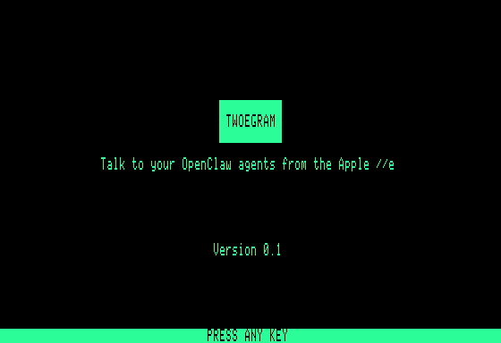
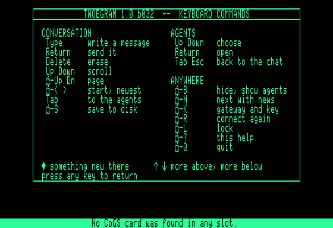
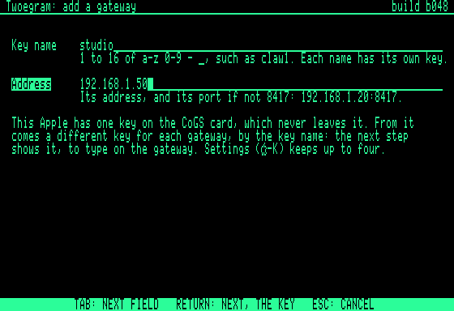
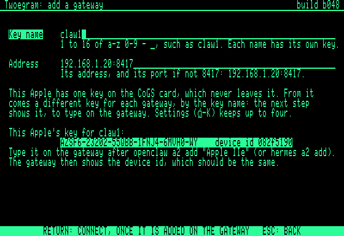
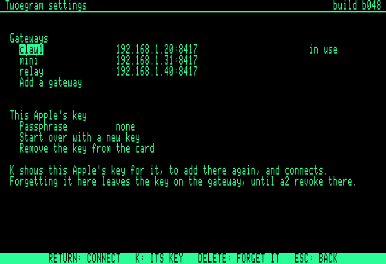
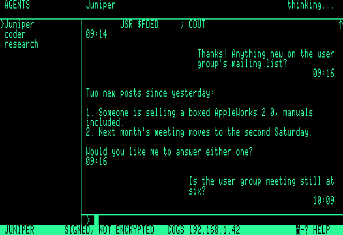
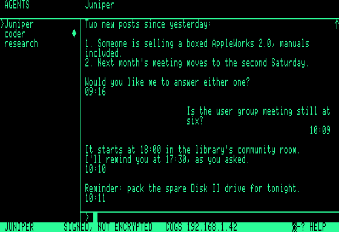
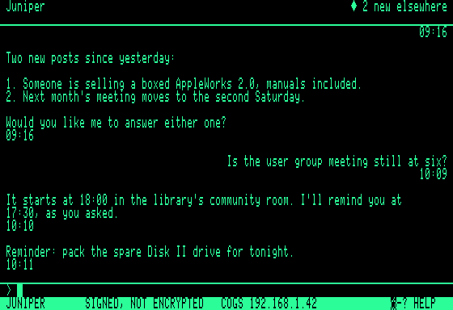

# Twoegram

### Conversations with Your Agents, for the Apple IIe

#### User's Guide · Version 1.0



---

## Contents

- [About This Guide](#about-this-guide)
- [Chapter 1: Getting Started](#chapter-1-getting-started)
- [Chapter 2: Setting Up Twoegram](#chapter-2-setting-up-twoegram)
- [Chapter 3: Having a Conversation](#chapter-3-having-a-conversation)
- [Chapter 4: Looking Back](#chapter-4-looking-back)
- [Chapter 5: More Than One Agent](#chapter-5-more-than-one-agent)
- [Chapter 6: Keeping Your Conversations Private](#chapter-6-keeping-your-conversations-private)
- [Appendix A: Quick Reference](#appendix-a-quick-reference)
- [Appendix B: Messages](#appendix-b-messages)
- [Appendix C: For the Technically Curious](#appendix-c-for-the-technically-curious)
- [Appendix D: Twoegram's Limits](#appendix-d-twoegrams-limits)

---

## About This Guide

Welcome to Twoegram. With Twoegram and a CoGS card, your Apple IIe can
hold a conversation with your **agents**: the helpers that live on your
OpenClaw gateway and keep your calendar, answer your questions, write
programs and look things up. You type at the Apple's keyboard, and their
answers appear on your 80-column screen.

This guide shows you how. You don't need to know how the agents work,
or how the network carries your words. If you can put a disk in a drive
and type a sentence, you can talk with your agents.

**Chapter 1** tells you what you need and how to start Twoegram.
**Chapter 2** shows how to introduce your Apple to your gateway, which
you do only once. **Chapter 3** takes you through a conversation: typing,
sending, and reading the answer. **Chapter 4** shows how to look back
through what was said. **Chapter 5** explains how to move between
agents, and how Twoegram tells you when one of them has something new.
**Chapter 6** explains how Twoegram keeps strangers out of your
conversations, and what it can't yet protect. At the back of the guide
you'll find a one-page summary of the keys, a list of the messages
Twoegram can show you, some notes for people who want to know how it all
works, and a list of Twoegram's limits.

### What Is an Agent?

An **agent** is a helper program that runs on your **gateway**: a modern
computer on your home network, running a program called OpenClaw. Each
agent has a name, such as `Juniper` or `coder`, and its own way of
working: one may look after your day, another may help you write
software.

Twoegram doesn't think for itself. It carries your words to the gateway,
and brings the agent's answer back to your Apple.

### Conventions Used in This Guide

Keys you press are shown in capital letters: RETURN, ESC, TAB, DELETE.
The arrow keys are called UP ARROW and DOWN ARROW.

When you see **OPEN-APPLE-Q**, hold down the OPEN-APPLE key (the key
with the outline of an apple, to the left of the space bar) and press Q.
Then let go of both keys.

Things you type are shown like `this`.

> **Important:** Paragraphs like this one contain information you need
> to know to avoid a problem.

> **By the way:** Paragraphs like this one contain extra information
> that's interesting, but not essential.

---

## Chapter 1: Getting Started

### What You Need

To use Twoegram, you need

- an **Apple IIe** with **128K** of memory and an **80-column text
  card**. (The enhanced Apple IIe is best: it shows Twoegram's special
  symbols. An unenhanced Apple IIe works too, with plain letters in
  their place.)
- a **CoGS card** installed in any slot, and connected to your home
  network.
- the **Twoegram disk**: on a floppy disk, a hard disk, or the CoGS
  card's own network disk.
- a **gateway** on the same home network, with Twoegram's channel
  installed: a computer running **OpenClaw**, or one running **Hermes
  Agent**. Whoever looks after your gateway can set this up in a few
  minutes; the instructions come with Twoegram, in `docs/INSTALL.md`
  for OpenClaw and `hermes/README.md` for Hermes.

> **Important:** Set up the CoGS card's network connection before you
> start Twoegram, using the card's own configuration screen. The CoGS
> card's manual tells you how. Twoegram uses the connection; it doesn't
> set it up.

### Starting Twoegram

1. Put the Twoegram disk in the startup drive, or choose it on your CoGS
   card.
2. Turn on the computer, or press CONTROL-OPEN-APPLE-RESET if it's
   already on.

The title screen appears (you saw it on the cover of this guide). The
build number under the title tells you exactly which copy of Twoegram
you have; mention it if you ever report a problem.

3. Press any key to continue.

The first time you start Twoegram, the **Add a Gateway** screen appears
next. Chapter 2 tells you what to type there. After that, Twoegram remembers,
and takes you straight to your conversation.

### The Status Bar

The bright bar along the bottom of the screen is the **status bar**. It
tells you where you are and what Twoegram is doing.


**Figure 1-1.** The conversation screen. The status bar is the bright
line at the foot.

From left to right, it shows the agent you're talking with, how your
conversation is protected (`SIGNED, NOT ENCRYPTED`; see Chapter 6), the
CoGS card's address on your network, and a reminder that OPEN-APPLE-?
brings help.

When Twoegram has something to tell you, such as `SENDING` or
`FETCHING OLDER MESSAGES`, its message takes over the status bar until
you press the next key.

If the gateway stops answering, perhaps because it is being restarted,
the middle of the status bar says `GATEWAY NOT ANSWERING` (or
`NO NETWORK`, or `GATEWAY BUSY`) in place of `SIGNED, NOT ENCRYPTED`.
Your conversation stays on the screen, and Twoegram keeps trying by
itself: after 5 seconds, then less and less often, but at least once a
minute. When the gateway answers again, the status bar goes back to
normal. You don't need to do anything.

> **By the way:** The pictures in this guide were made on a modern
> computer, because the Apple IIe simulator used for them has no CoGS
> card. The pictures of a conversation were drawn by Twoegram's own
> screen program, using the Apple IIe's own characters, so they look
> exactly as your screen will. The conversation in them is made up, and
> the addresses are examples; yours will be different.

### Getting Help

Whenever you need a reminder, press **OPEN-APPLE-?**. A box appears with
every key that Twoegram understands, and what the two little symbols in
the heading mean (Chapters 4 and 5 explain them). Press any key to make
it go away.



**Figure 1-2.** The help box. This picture was taken without a CoGS
card, so the status bar below it says so.

### Quitting

To stop using Twoegram, press **OPEN-APPLE-Q**. Twoegram returns you to
ProDOS. Your conversations aren't lost: they're kept on the gateway, and
appear again the next time you start Twoegram.

---

## Chapter 2: Setting Up Twoegram

Before your Apple can talk with your agents, the gateway has to know
it. You introduce them once, with a **key**: a secret password that
only your Apple and that gateway hold. Your Apple makes its own key,
and you type it on the gateway. After that, Twoegram remembers the
gateway, and connects by itself each time you start it.

### Adding Your First Gateway

The first time you start Twoegram, the **Add a Gateway** screen appears
by itself.

1. On the **Key name** line, type a short name for the gateway, such as
   `claw1`: up to 16 small letters, digits, dashes and underlines. Your
   Apple's key for this gateway is made from this name, so each gateway
   you name gets a key of its own.
2. Press TAB to move to the **Address** line, and type the gateway's
   address, such as `192.168.1.20:8417`. You can leave off the
   `http://` at the beginning, and the `:8417` at the end if the
   gateway uses that port: Twoegram adds them for you.

   

   **Figure 2-1.** Adding a gateway

3. Press RETURN. Twoegram saves the gateway on the disk.

The first time, Twoegram also makes your Apple's own secret: the CoGS
card draws it from its own random numbers, and keeps it. There's
nothing for you to do. This secret never leaves the card: Twoegram
never shows it, sends it, or writes it on a disk.

### Giving the Key to the Gateway

Twoegram now shows your Apple's key for this gateway: 27 letters and
numbers, in groups of five, and beside it a **device id** of eight
letters and digits.



**Figure 2-2.** Your Apple's key for the gateway

1. At the gateway, whoever looks after it types this command:

   ```
   openclaw a2 add "Apple IIe"
   ```

   or, on a gateway running Hermes Agent:

   ```
   hermes a2 add "Apple IIe"
   ```

   The gateway asks for the key, and doesn't show it as it's typed.
   Type the key exactly as your Apple shows it. You can leave out the
   dashes, and capital or small letters are both fine.
2. The gateway answers with a device id. It should be the same as the
   one on your Apple's screen. If it's different, the key was mistyped:
   remove that one (see "For Whoever Looks After the Gateway" in Chapter
   6) and type it again.
3. Back at the Apple, press RETURN. The key disappears from the screen,
   and Twoegram connects. The status bar says `SAYING HELLO TO` and the
   gateway's address, and in a moment your conversation appears.

> **By the way:** Press ESC instead of RETURN to go back to the key
> name and address. Press ESC there to leave without adding anything.

### Settings

Press **OPEN-APPLE-K** at any time for the **Settings** screen. It lists
the gateways Twoegram knows, with the one in use first, and below them
the things that belong to your Apple's key.



**Figure 2-3.** Settings

Move from line to line with UP ARROW and DOWN ARROW. The status bar,
and the lines below the list, say what each line does. Press ESC to go
back to your conversation.

### Talking to Another Gateway

Your Apple talks to one gateway at a time, but Settings keeps up to
four, each with a key of its own.

- **To add one,** choose **Add a gateway** and press RETURN. Type its
  key name and address, and give it its key, just as for your first.
- **To move to another,** choose it and press RETURN. The keys never
  need typing again.
- **To show a gateway's key again,** to give it to the gateway once
  more, choose the gateway and press K. Twoegram moves to that gateway
  and shows its key; press RETURN to connect.
- **To forget one,** choose it, press DELETE, then Y. This forgets it
  only on the Apple: the gateway keeps the key until it's removed there
  (see "Keeping Your Key Safe" in Chapter 6).

Adding a fifth gateway forgets the one you used longest ago.

> **Important:** The key name is part of the key. If you add a gateway
> again under a different key name, your Apple makes a different key for
> it, and that gateway has to be given the new one.

### Where Your Key Is Kept

Your Apple's secret is never written on a disk. It's kept in a small
corner of the CoGS card's own memory, which remembers it even when the
computer is off. That way, a copy of your Twoegram disk is no use to
anyone else. Each gateway's key is worked out from the secret whenever
it's needed, and never kept anywhere on the Apple.

To remove the secret from the card, for example before you give the
card away, choose **Remove the key from the card** in Settings, press
RETURN, then Y. A new secret is made the next time you add a gateway.

To replace the secret with a new one, choose **Start over with a new
key**, press RETURN, then Y. Every gateway then needs its new key:
Twoegram shows the key for the gateway in use straight away, and for
each of the others when you move to it.

> **By the way:** Earlier versions of Twoegram had you type a key made by
> the gateway (with `a2 pair`). This version doesn't use those. If your
> card has one, Twoegram makes a secret of its own in its place, and
> shows the gateway its new key to add.

### A Passphrase, If You Want One

Anyone who starts your Apple can use the key on the card. If others can
reach your Apple, give the key a **passphrase**: a phrase only you know,
which Twoegram asks for every time it starts. With a passphrase, the
card holds the key scrambled, and only the passphrase unscrambles it.
The passphrase itself is never kept anywhere, on the card, on a disk, or
on the gateway. One passphrase covers your Apple's key for every
gateway.

1. Press OPEN-APPLE-K for Settings.
2. Choose **Passphrase** and press RETURN.
3. Type a phrase of 8 to 32 characters. Twoegram shows a star for each
   character. Press RETURN.
4. Twoegram asks for it again, to be sure of it: type it once more and
   press RETURN.

From then on, Twoegram starts by asking for the passphrase. If you type
it wrong, the gateway won't recognize the key it makes, and Twoegram
asks again.

To change the passphrase, choose **Passphrase** and press RETURN again.
To stop using one, choose **Passphrase**, press DELETE, then Y.

> **Important:** Twoegram can't tell you a passphrase you've forgotten,
> and nobody else can either. If you forget it, press ESC when Twoegram
> asks for it, and Settings appears. Choose **Start over with a new
> key**, give each gateway its new key, and remove the old ones from the
> gateways' lists.

A longer passphrase is a stronger one. Several ordinary words strung
together, such as `purple kettle on the stair`, are easier to remember
and harder to guess than one odd word.

### Locking Twoegram

When you have a passphrase, press **OPEN-APPLE-L** to lock Twoegram
when you step away. The screen clears and shows only a line for the
passphrase. Twoegram also locks itself after 10 minutes without a key
pressed.

While it's locked, Twoegram has forgotten your key and your messages,
and it stops checking for new ones. Type the passphrase and press
RETURN: Twoegram checks it on the Apple, connects to the gateway again,
and brings your conversation back.

### If the Gateway Doesn't Know Your Key

If the gateway doesn't know your Apple's key (perhaps someone removed it
from the gateway's list, or it was never given this key), Twoegram says
so and shows the key, ready to give to the gateway as described in
"Giving the Key to the Gateway". If it happens in the middle of a
conversation, press OPEN-APPLE-R for the same.

---

## Chapter 3: Having a Conversation

### The Conversation Screen

When Twoegram has connected, you see the **conversation screen**.


**Figure 3-1.** The conversation screen

- At the left is the **list of agents**. The one you're talking with is
  marked with >.
- At the top of the conversation is the agent's name.
- In the middle is the conversation itself, newest at the bottom. The
  agent's words are at the left. Your own are at the right. Each message
  ends with the time it was sent.
- At the bottom, by the >, is the **compose line**, where you type.

Twoegram opens the first agent in the list, with its most recent
messages.

### Sending a Message

1. Type your message. It appears on the compose line.

   

   **Figure 3-2.** Typing a message

   If you make a mistake, press DELETE to erase the last letter. A long
   message can run to 255 characters; the compose line grows to three
   rows to show it.

2. Press RETURN to send it.

The status bar says `SENDING`, and your message moves up into the
conversation, at the right. The compose line is empty again, ready for
your next message. While the agent works on its answer, the top of the
screen says **thinking...**



**Figure 3-3.** The agent is thinking

You don't have to wait. You can scroll back, change agents, or start
typing your next message. Keep typing even while Twoegram is waiting
for the gateway: it remembers up to 32 keys you press meanwhile, and puts
them on the compose line as soon as it can.

### Reading the Answer

When the answer is ready, it appears at the left, and **thinking...**
disappears.


**Figure 3-4.** The answer arrives

A long answer may arrive in several parts, one after another, each with
its own time. Twoegram asks the gateway for news every five seconds,
and every second while an agent is thinking.

> **By the way:** Agents on modern computers like to decorate their
> answers with pictures called emoji. Your Apple shows the most common
> ones as words in colons, such as `:wave:`. A "thumbs up" or a check
> mark appears as a real check mark: look for it after "Done" in Figure
> 4-1. Headings, bold type and lists become plain text; a program
> listing keeps its lines just as the agent wrote them.

> **Important:** Twoegram sends a message only if it can. If the status
> bar says that something went wrong, your message stays on the compose
> line. Press RETURN to try again.

### Talking to OpenClaw Itself

Some messages are for OpenClaw rather than the agent. They begin with a
slash. Two useful ones:

| Type | To |
|---|---|
| `/status` | see how the agent is set up, and how busy it has been |
| `/new` | start a fresh conversation, so the agent forgets what came before |

Your gateway may know more; whoever looks after it can tell you.

### If Your Gateway Runs Hermes Agent

A Hermes gateway gives you one agent, called **Hermes** unless whoever
looks after it has named it otherwise. Everything in this manual works
the same way. Hermes's own slash commands work too, such as `/new` and
`/stop` (which stops the answer it is working on).

Before Hermes runs a command that could change something, it asks you
first. The question arrives as a message that begins **:warning:
Hermes wants to run a command that needs your OK**, shows the command,
and says why it asked. To let it run once, type

```
/approve
```

and press RETURN. To refuse, type `/deny`. If you don't answer within
five minutes, the command doesn't run.

The first time you write, Hermes may say that no home channel is set.
That is where it sends the results of jobs you schedule. To have them
come to your Apple, type `/sethome`.

---

## Chapter 4: Looking Back

### Scrolling

Press **UP ARROW** to look back through the conversation a line at a
time, and **DOWN ARROW** to come forward again. To move a whole screen at
a time, hold down OPEN-APPLE as you press the arrow.

Two small arrows at the right edge of the conversation work like a
simple scroll bar. An **up arrow** at the top means there's more above,
and a **down arrow** at the bottom means there's more below. When the
up arrow is gone, you're at the very start of the conversation; when
the down arrow is gone, you're at the newest message.


**Figure 4-1.** Looking back. The arrows at the right edge say there's
more above and more below.

You can go back as far as the conversation goes. Twoegram keeps the
latest messages in its memory, and when you scroll past the oldest of
them, it fetches earlier ones from the gateway: the status bar says
`FETCHING OLDER MESSAGES` for a moment.

To jump, press **OPEN-APPLE-<** for the very start of the conversation,
or **OPEN-APPLE->** to return to the newest. Either one fetches what it
needs from the gateway in one go, however long the conversation is.
(The gateway keeps the latest 500 messages of each conversation, so the
start is the oldest of those.)

### When Something New Arrives

While you're looking back, the screen stays still, even if the agent
sends something new. Twoegram doesn't snatch the page away while you're
reading. Instead, a **diamond** appears beside the agent's name, at the
top of the screen and in the list.


**Figure 4-2.** The diamond beside `Juniper` says something new has
arrived below.

Scroll down to the bottom, or press OPEN-APPLE->, to read it. The
diamond disappears once you've reached it.

### Saving a Conversation to Disk

To keep a conversation, press **OPEN-APPLE-S**. Twoegram saves the whole
conversation with the agent you're talking to, from its first message to
its newest, as a text file you can read in any Apple II word processor
or editor, or copy to another computer.

1. Press OPEN-APPLE-S. The status bar asks `SAVE AS:` and offers a name
   made from the agent's, such as `PINCHY.TXT`.
2. Press RETURN to use that name, or press DELETE and type another. A
   name alone saves on the Twoegram disk; to save on another disk,
   type its name first, as in `/LETTERS/PINCHY.TXT`.
3. If a file by that name is already there, Twoegram asks whether to
   replace it. Press **Y** to replace it, or **N** to leave it alone.

Twoegram fetches the conversation from the gateway a page at a time and
writes each page as it arrives, so the status bar counts the messages as
they're saved. A long conversation takes a little while. Press **ESC** to
stop early; the file keeps the messages saved so far. When it's done,
the status bar says how many messages were saved, and the conversation
returns to the newest message.

The file begins with the agent's name. Then each message has the time it
was sent and who sent it, `You` or the agent, on a line of its own, with
the message below:

    Twoegram: the conversation with Pinchy

    08:40 You
    Is the light in the office on?

    08:41 Pinchy
    Candle 12 is off.

The file holds the conversation as the gateway keeps it: the latest 500
messages. It doesn't have dates, only times. A check mark in a message
becomes `+` in the file.

> **Note:** A saved conversation is plain text. Anyone with the disk can
> read it, passphrase or not. Keep it on a disk you keep to yourself.

---

## Chapter 5: More Than One Agent

### Choosing an Agent

The list at the left shows every agent your Apple may talk to.

1. Press **TAB** (or ESC). A bright bar appears in the list.

   

   **Figure 5-1.** Choosing an agent

2. Press UP ARROW or DOWN ARROW to move the bar to the agent you want.
3. Press RETURN.

Twoegram fetches that agent's latest messages, and you can carry on as
before. Each agent has its own conversation: what you say to one, the
others don't hear.

To go back to typing without changing agents, press TAB or ESC again.

### Which Agents Have Something New

Twoegram asks after the agent you're talking with, but each answer from
the gateway also says how many new messages are waiting from every other
agent. When another agent sends you something, a **diamond** appears
at the right of its name in the list.



**Figure 5-2.** `coder` has something new.

Press **OPEN-APPLE-N** to go straight to the next agent with news. If
there's none, the status bar says `NOTHING NEW ELSEWHERE`. The diamond
disappears once you've opened the agent.

### Your Agents' Names

Twoegram shows each agent by the name it has on the gateway: the one
OpenClaw shows in `openclaw agents list`. If an agent has no name of its
own, Twoegram shows its **id**, the short word OpenClaw knows it by,
such as `main` or `coder`. In the pictures in this guide, the agent with
the id `main` is called `Juniper`.

To rename an agent, change its name on the gateway: either the `Name:`
line in the `IDENTITY.md` file in the agent's workspace, or the agent's
`identity.name` in OpenClaw's settings, which comes first if both are
set. Twoegram shows the new name the next time it says hello to the
gateway (press OPEN-APPLE-R to say hello now).

> **By the way:** Names are shown in plain letters, so an emoji in a
> name is left out, and accented letters lose their accents. Names can
> be up to 16 characters long, and the list has room for all of them.

### Hiding the List

To give the conversation the whole width of the screen, press
**OPEN-APPLE-B**. Press it again to bring the list back.



**Figure 5-3.** With the list hidden, the top of the screen counts the
new messages from other agents.

With the list hidden, there's nowhere to show the other agents'
diamonds, so the top of the screen counts their new messages instead, as
in Figure 5-3.

---

## Chapter 6: Keeping Your Conversations Private

Your agents can do real work for you: read your calendar, send a
message, change a file. So it matters that nobody else can talk to them
pretending to be you, and that nobody can slip a false answer onto your
screen. Twoegram is built to prevent both. This chapter explains what it
protects, what it doesn't yet, and the few habits that keep it that way.

### What Twoegram Protects

- **Only your Apple can talk to your agents.** Every message Twoegram
  sends carries a **signature** made with your key. The gateway checks
  it, and ignores anything that doesn't carry a good one. Your key never
  crosses the network.
- **Only your gateway can answer.** Every answer carries the gateway's
  signature too, and Twoegram checks it before showing a word. If an
  answer doesn't check, Twoegram stops and says `A REPLY WAS NOT SIGNED
  WITH THIS KEY: STOPPED`.
- **A message can't be sent twice.** Each message is numbered, and the
  gateway refuses a number it has seen, so nobody can record your
  message and send it again later.
- **Guessing doesn't work.** After five wrong tries in a few minutes,
  the gateway locks your Apple out for 15 minutes.

That's why the status bar says **SIGNED**.

### What It Doesn't Yet Protect

**Eavesdroppers on your network.** Your conversation crosses your home
network as plain text. Anyone with the right equipment on your network
could read it, although they couldn't change it or join in. That's why
the status bar also says **NOT ENCRYPTED**.

**Someone sitting at your Apple, unless you give it a passphrase.**
Without a passphrase, anyone who turns on your Apple with the Twoegram
disk, or finds it running, can talk to your agents as you. With one
(Chapter 2), Twoegram asks for it at every start, and OPEN-APPLE-L, or
10 minutes without a key, locks it again.

A passphrase protects against someone at the keyboard. It's weaker
against someone who takes the CoGS card away *and* has recorded your
network: with both, a computer could try one guess after another until
one works. A long passphrase makes that take far too long to be worth
it.

> **Important:** Use Twoegram only on your own home network, and never
> make your gateway reachable from the Internet. If others can reach
> your Apple, give your key a passphrase, and lock Twoegram when you step
> away. A future version of Twoegram will encrypt the conversation.

### What Your Agents Can Do from the Apple

Your gateway decides what an agent may do, not Twoegram. To the
gateway, your Apple is a trusted acquaintance rather than the gateway's
owner, so an agent you talk to from the Apple doesn't get a few of the
gateway's most powerful tools: using its screen, managing its sessions
and plugins, or changing the gateway itself. If you ask for something
that needs one, the agent will tell you it can't do it from here.

Most of an agent's tools stay available, though, and that includes
running commands on the gateway computer. That's how an agent can turn
off your lights when you ask from the Apple: it runs the command that
tells your home-automation system to. It also means that whoever can use
your Apple can ask an agent to do almost anything it could do for you
elsewhere. Give your key a passphrase, and keep Twoegram locked when
you're away from it.

Whoever looks after the gateway can narrow what an agent may do for the
Apple, or give the Apple an agent of its own with fewer tools.

OpenClaw's own commands, such as `/status` and `/new`, work from the
Apple unless the gateway turns them off.

### What the Gateway Keeps

The gateway keeps the newest 500 messages of each conversation, so
Twoegram can show them to you again, in files that only the gateway's
own account can read. OpenClaw keeps its own record of each
conversation too, as it does for every other way of talking to your
agents. Your Apple keeps nothing on its disks unless you save a
conversation (Chapter 4): otherwise the conversation lives in the
Apple's memory only while Twoegram runs.

### Keeping Your Key Safe

Your Apple's secret stays in the CoGS card, and is never shown. Each
gateway's key appears on the screen only when you add the gateway, or
ask for it in Settings, and disappears at the next key you press. There's no need to write it
down: type it straight from the screen at the gateway. If you do copy it
onto paper, tear the paper up once the gateway has the key.

If the Apple or the card leaves your hands:

1. Ask whoever looks after each gateway to remove the Apple from that
   gateway's list (`openclaw a2 revoke`, or `hermes a2 revoke`). From
   then on, its key is worthless. The gateway forgets the conversations
   it kept for that Apple at the same time.
2. Press OPEN-APPLE-K, choose **Remove the key from the card**, press
   RETURN, then Y, to wipe the secret from the card.

If someone sees a gateway's key, remove it from that gateway's list,
add the gateway again under a new key name, and give it the new key.
The other gateways' keys aren't affected.

### For Whoever Looks After the Gateway

- Keep the a2 channel's port (8417 unless you changed it) open to your
  home network only, and never forward it to the Internet. Setting the
  channel's `host` to the gateway's own address on your home network,
  rather than `0.0.0.0`, keeps it off any other network the gateway
  computer is on.
- Give the Apple only the agents it needs, with the channel's `agents`
  setting. An agent with fewer tools is the safest one to talk to from
  the Apple.
- `openclaw a2 add` takes an Apple's key, which the Apple shows; it
  asks for it without showing it. `openclaw a2 list` shows every Apple
  the gateway knows. Revoke any you don't recognize or no longer use.
- `openclaw security audit` checks the gateway's settings. It has
  nothing to say about the a2 channel once an Apple is paired.
- The gateway's log notes every hello, with the Apple's name and
  address, and every lockout.

---

## Appendix A: Quick Reference

### Everywhere

| Press | To |
|---|---|
| OPEN-APPLE-? | see the list of keys |
| OPEN-APPLE-B | hide or show the list of agents |
| OPEN-APPLE-N | go to the next agent with something new |
| OPEN-APPLE-K | Settings: the gateways, and the passphrase |
| OPEN-APPLE-R | connect to the gateway again (and show the key, if the gateway doesn't know it) |
| OPEN-APPLE-L | lock Twoegram (with a passphrase) |
| OPEN-APPLE-Q | quit Twoegram |

### In the Conversation

| Press | To |
|---|---|
| any letter | type a message |
| RETURN | send it |
| DELETE | erase the last letter |
| UP ARROW, DOWN ARROW | scroll a line |
| OPEN-APPLE-UP ARROW, OPEN-APPLE-DOWN ARROW | scroll a screen |
| OPEN-APPLE-<, OPEN-APPLE-> | go to the start of the conversation, or the newest message |
| OPEN-APPLE-S | save the conversation to disk |
| TAB, ESC | choose another agent |

### In the List of Agents

| Press | To |
|---|---|
| UP ARROW, DOWN ARROW | move the bar |
| RETURN | open the agent |
| TAB, ESC | return to the conversation |

### Adding a Gateway

| Press | To |
|---|---|
| TAB | move between the key name and the address |
| RETURN | save the gateway, and show its key |
| RETURN, with the key showing | connect, once the gateway has the key |
| ESC | go back a step, or leave |

### In Settings

| Press | To |
|---|---|
| UP ARROW, DOWN ARROW | choose a line |
| RETURN | on a gateway, connect to it; on the others, do what they say |
| K | on a gateway, show its key, then connect |
| DELETE | on a gateway, forget it; on Passphrase, stop using one |
| ESC | go back to the conversation |

### The Symbols

| You see | It means |
|---|---|
| > in the list | the agent you're talking with |
| a diamond beside a name | something new: below the screen, or from that agent |
| an up arrow, right edge, top | there's more of the conversation above |
| a down arrow, right edge, bottom | there's more below; you're looking back |
| **thinking...**, top right | the agent is working on an answer |
| a check mark in a message | the agent's "thumbs up" or check mark |

---

## Appendix B: Messages

These are the messages Twoegram may show, what they mean, and what to
do.

### When Starting

**TWOEGRAM NEEDS AN APPLE //E**
Twoegram runs only on an Apple IIe (or a later Apple II).

**TWOEGRAM NEEDS 128K**
Twoegram keeps your conversation in the Apple IIe's extra 64K. Install
an extended 80-column card.

**AUX MEMORY IS IN USE BY A RAM DISK**
Another program has left a RAM disk in the memory Twoegram needs. Start
the computer again from the Twoegram disk.

**No CoGS card was found in any slot.**
Make sure the card is firmly seated in its slot, then start Twoegram
again.

**WAITING FOR THE NETWORK...**
The CoGS card isn't connected to your network yet. This is normal for a
few seconds after you turn the computer on; Twoegram waits up to 20
seconds.

**The card has no network.**
Twoegram waited 20 seconds and the CoGS card still wasn't connected.
Check the card's configuration screen, then press OPEN-APPLE-R.

**No gateway yet: OPEN-APPLE-K, then Add a gateway.**
You left the Add a Gateway screen before adding one. Press OPEN-APPLE-K
when you're ready.

**This Apple's key is locked with a passphrase.**
Type your passphrase and press RETURN. Press ESC instead to go to
Settings, where **Start over with a new key** makes a new one.

**Locked: a new key, without the passphrase, is Start over below.**
Settings, reached with ESC from the passphrase. If you've forgotten the
passphrase, choose **Start over with a new key**; otherwise press ESC.

**The gateway does not know the key that passphrase makes: is it right?**
The passphrase was probably mistyped. Type it again.

**The key on the card is locked with a passphrase**
You pressed ESC instead of typing the passphrase, and left Settings
too. Press OPEN-APPLE-R, and Twoegram asks for the passphrase again.

**ADDING A GATEWAY, TWOEGRAM.SETUP, COULD NOT BE READ FROM THE DISK**
**SETTINGS, TWOEGRAM.PREFS, COULD NOT BE READ FROM THE DISK**
These screens are files of their own on the Twoegram disk, read when
they're needed. Make sure the Twoegram disk is still in the drive, with
`TWOEGRAM.SETUP` and `TWOEGRAM.PREFS` on it, and try again.

### When Setting Up

**GIVE THE GATEWAY A KEY NAME: 1 TO 16 OF A-Z 0-9 - _**
Your Apple's key for a gateway is made from its key name: type one on
the Key name line.

**THE ADDRESS IS AN ADDRESS AND PORT, FOR EXAMPLE 192.168.1.20:8417**
What you typed on the Address line isn't an address Twoegram can use.

**MAKING THIS APPLE'S KEY**
The first time you add a gateway (or after starting over), the CoGS
card makes your Apple's secret. It takes a moment.

**RETURN: CONNECT, ONCE IT IS ADDED ON THE GATEWAY**
Twoegram is showing a gateway's key. Give it to the gateway (Chapter 2),
then press RETURN; or ESC to go back to the key name and address.

**PRESS A KEY TO GO ON**
Something went wrong, said on the line above. The gateway or the key is
still usable for now; press any key.

**Four gateways at most: the one used longest ago is forgotten.**
Settings keeps four gateways. Adding a fifth forgot the one you used
longest ago; add it again if you need it.

**The disk is write-protected: the gateways are not saved.**
**The gateways could not be saved: ProDOS error** *number*
Twoegram couldn't write `TWOEGRAM.CFG`. It goes on with the gateway you
chose, but won't remember it next time.

**The key could not be kept on the card.**
The CoGS card wouldn't save the key. Press any key to go on; you'll
have to give the gateway a new key next time.

**THE KEY IS LOCKED: START AGAIN AND TYPE THE PASSPHRASE**
The key on the card is locked, and you didn't unlock it when Twoegram
started. Start Twoegram again and type the passphrase.

**THERE IS NO KEY YET: ADD A GATEWAY, AND ONE IS MADE**
The card doesn't hold a key for Twoegram yet. Choose **Add a gateway**.

**FORGET** *name* **HERE? Y OR N**
Press Y to remove the gateway from Settings. The gateway itself still
knows the key until it's removed there.

**A NEW KEY: EVERY GATEWAY MUST HAVE THIS APPLE ADDED AGAIN. Y OR N**
You chose **Start over with a new key**. Press Y to make one, or any
other key to keep the key you have.

**REMOVE THE KEY FROM THE CARD? Y OR N**
You chose **Remove the key from the card**. Press Y to remove it.

**A passphrase is at least 8 characters.**
Make it longer. Several words together are easiest.

**TYPE IT AGAIN, THEN RETURN**
Twoegram asks twice, to be sure you typed what you meant.

**The two differ: type the passphrase again.**
The second typing didn't match the first. Start again with the first.

**THE KEY IS LOCKED WITH THE PASSPHRASE**
The passphrase is set. Twoegram asks for it from the next start on.

**NO PASSPHRASE IS IN USE**
You pressed DELETE on Passphrase, but the key has no passphrase.

**THE KEY NO LONGER NEEDS A PASSPHRASE**
Twoegram won't ask for the passphrase again.

### When Connecting

**SAYING HELLO TO** *address*
Twoegram is introducing itself to your gateway.

**NOT A TWOEGRAM GATEWAY AT THAT ADDRESS**
Something answered at that address, but not Twoegram's channel. Check
the address, especially the number after the colon.

**THE GATEWAY DOES NOT KNOW THIS KEY**
**BAD SIGNATURE: IS THE KEY RIGHT?**
The gateway doesn't recognize your key. When connecting, Twoegram shows
the key, saying **The gateway does not know this Apple's key yet: add
it there** (or, once you've tried, **still does not know**): give the
gateway the key (Chapter 2) and press RETURN. If this happens in the
middle of a conversation, the key has been taken back (revoked) on the
gateway, or the copy on the card has changed (a card firmware upgrade
or reset can do that). Either way the message pane says
**OPEN-APPLE-R shows this Apple's key, to add on the gateway again.**
Do just that. If the card's key changed, revoke the
old device on the gateway too (`openclaw a2 list` shows it, `openclaw
a2 revoke` takes it away).

**LOCKED OUT AFTER BAD TRIES: WAIT 15 MINUTES**
The gateway saw too many wrong keys from your Apple. Wait 15 minutes,
then press OPEN-APPLE-R.

**DNS FAILED: TRYING AGAIN**, **TIMED OUT: TRYING AGAIN**,
**CONNECTION REFUSED: TRYING AGAIN**
The card couldn't reach the gateway. Twoegram keeps trying by itself,
less often as time goes by, and opens your conversation as soon as the
gateway answers. If it doesn't, make sure the gateway is turned on and
running OpenClaw, and that the address is right.

**CARD STOPPED ANSWERING**
The CoGS card didn't answer Twoegram. Turn the computer off and on
again; if it keeps happening, run A2PROBE.SYSTEM (see Appendix C).

### During a Conversation

**FETCHING MESSAGES**, **FETCHING OLDER MESSAGES**, **FETCHING NEWER MESSAGES**
Twoegram is bringing messages from the gateway.

**SENDING**
Twoegram is sending your message.

**NOT CONNECTED: NOTHING CAN BE SENT**
Twoegram isn't connected to the gateway. Press OPEN-APPLE-R to connect.

**NOTHING NEW ELSEWHERE**
You pressed OPEN-APPLE-N, but no other agent has anything new.

**GATEWAY NOT ANSWERING**, **NO NETWORK**, **GATEWAY BUSY** in the status bar
The gateway can't be reached just now, or is too busy. Twoegram keeps
trying by itself and puts the status bar right when it can. If you send
a message meanwhile, the reason takes over the status bar (for example,
**TIMED OUT**) and your message stays on the compose line; press RETURN
to send it again once the status bar says `SIGNED, NOT ENCRYPTED`.

**THE SESSION ENDED**
The gateway was restarted, or you were away for half an hour, and it
didn't answer when Twoegram said hello again. Twoegram keeps trying.

**A REPLY WAS NOT SIGNED WITH THIS KEY: STOPPED**
An answer arrived that your gateway didn't sign. Twoegram didn't show
it, and stops talking to the gateway until you press OPEN-APPLE-R.
Something on your network may be interfering; tell whoever looks after
the gateway.

When an agent is removed from the gateway while you're talking with it,
Twoegram fetches the list of agents again by itself and opens the first
one. Agents that are added appear the same way, the next time Twoegram
says hello.

**TOO LONG FOR THE GATEWAY**, **THE GATEWAY REFUSED**
The gateway couldn't take that message. Your message is still on the
compose line; shorten it, or try again.

**(The gateway could not answer: ...)** as an agent's message
The gateway received your message but couldn't get an answer from the
agent. The rest of the message says why. Show it to whoever looks after
the gateway.

### When Saving

**SAVED** *number* **MESSAGES AS** *name*
The whole conversation is in the file.

**NOT SAVED**
You pressed ESC at the name, or N when asked whether to replace a file.

**NOTHING TO SAVE: NO MESSAGES WITH** *agent*
The conversation is empty, so Twoegram made no file.

**NOT SAVED: THE GATEWAY DID NOT GIVE THE CONVERSATION**
The gateway didn't answer when Twoegram asked for the start of the
conversation, so there's no file. Save again once the status bar says
`SIGNED, NOT ENCRYPTED`.

**NOT CONNECTED: NOTHING TO SAVE**
Twoegram saves from the gateway, so it must be connected. Press
OPEN-APPLE-R to connect.

**SAVING STOPPED: THE FILE HAS THE FIRST** *number* **MESSAGES**
You pressed ESC while Twoegram was saving. The file has the start of the
conversation, up to that point.

**THE GATEWAY STOPPED ANSWERING: THE FILE HAS THE FIRST** *number* **MESSAGES**
The gateway stopped answering partway through. Save again once the
status bar says `SIGNED, NOT ENCRYPTED`.

**THE DISK IS WRITE-PROTECTED**
Slide the disk's write-protect tab, or save on another disk. A CoGS
network disk may be read-only; type the name of another disk first, as
in `/LETTERS/PINCHY.TXT`.

**THE DISK IS FULL**
Save on another disk, or delete something from this one.

**THE DISK FAILED (I/O ERROR $27): TRY AGAIN**
The disk didn't take a block. Save again; it usually works the second
time.

**NOT A PRODOS NAME: LETTERS, DIGITS AND PERIODS, A LETTER FIRST**
A ProDOS file name is up to 15 letters, digits and periods, and starts
with a letter.

**NO SUCH DISK OR FOLDER: TYPE /DISK/NAME, OR JUST A NAME**
The disk or folder you named isn't there. Check its name, or type just
a file name to save on the Twoegram disk.

**COULD NOT SAVE, PRODOS ERROR $**_nn_
ProDOS refused, for a reason Twoegram has no words for. The number is
ProDOS's own error code.

**SAVING, TWOEGRAM.SAVE, COULD NOT BE READ FROM THE DISK**
Saving is a file of its own on the Twoegram disk, read when it's needed.
Make sure the Twoegram disk is still in the drive, with
`TWOEGRAM.SAVE` on it, and try again.

---

## Appendix C: For the Technically Curious

### How Twoegram Uses Your Apple

Twoegram is written in C and 6502 assembly language. The CoGS card does
the work of the network: it connects to the gateway, and holds each
answer while Twoegram reads it. Twoegram signs every message with
HMAC-SHA256, using the CoGS card to compute the SHA-256 hashes the
signatures are built from; the Apple only prepares the key and checks
the result.

The messages you're reading are kept in the Apple IIe's auxiliary
memory, the second 64K of your 128K. ProDOS normally keeps a small disk,
`/RAM`, in that memory; Twoegram turns `/RAM` off when it starts, and
ProDOS turns it back on the next time you start up. Anything you had
saved on `/RAM` is cleared.

### The Gateway's Side

On the gateway, Twoegram's channel is a plugin called `a2`: an OpenClaw
plugin, or a Hermes Agent plugin that speaks exactly the same way to
your Apple. It listens on its own port (8417), checks every signature before
anything reaches an agent, and gives each of your agents a conversation
of its own, separate from any other way you talk to them. It keeps the
latest 500 messages of each conversation for your Apple to look back
through. The file `docs/INSTALL.md` tells whoever looks after the
gateway how to install it on OpenClaw, `hermes/README.md` on Hermes
Agent, and `docs/PROTOCOL.md` describes exactly what
travels between the Apple and the gateway.

### Starting from the CoGS Network Disk

Twoegram works well when you start it from the CoGS card's network disk.
The card carries both the disk and your conversation, so Twoegram takes
care never to use the disk while a message is on its way. Your key is
never written to the disk, which is itself kept on another computer.

### A Program for Checking Your Card

The Twoegram disk also has **A2PROBE.SYSTEM**, a testing program for
whoever looks after your gateway. It checks the CoGS card, then, with a
test key kept in a file named `A2PROBE.CFG`, every step of a
conversation with the gateway, and reports what it finds. To use it,
quit Twoegram and choose it from the ProDOS menu. The file
`docs/PROBE.md` tells how to set it up.

### The Files Twoegram Keeps

| Where | Contains |
|---|---|
| `TWOEGRAM.CFG`, on the Twoegram disk | the gateways you've added, with their key names and addresses, the one in use first |
| `TWOEGRAM.SETUP`, on the Twoegram disk | the Add a Gateway screen itself, read from the disk when it's needed |
| `TWOEGRAM.PREFS`, on the Twoegram disk | the Settings screen itself, read the same way |
| `TWOEGRAM.SAVE`, on the Twoegram disk | the part of Twoegram that saves conversations, read from the disk when it's needed |
| a text file of your choosing | a conversation you saved with OPEN-APPLE-S |
| the CoGS card's memory | your key, scrambled if you gave it a passphrase |
| the gateway | your conversations |

---

## Appendix D: Twoegram's Limits

### How Much Twoegram Can Hold

| | Limit | When there's more |
|---|---|---|
| A message you type | 255 characters | Twoegram doesn't take more. Send it in two parts. |
| A part of an agent's answer | 1,500 characters | The gateway sends a longer answer in parts, each its own message. |
| Messages in memory at once | 64 | Twoegram forgets the ones furthest from what you're reading, and fetches them again if you scroll back to them. |
| Messages the gateway keeps for you | the latest 500 for each agent | Earlier ones are forgotten by the gateway, though the agent's own records may keep them. |
| Agents | 8 | Only the first eight are listed. |
| An agent's name | 16 characters | The list shows all 16. |
| Keys typed ahead | 32 | Keys after the 32nd, pressed while Twoegram is busy, are lost. |
| Checking for news | every 5 seconds; every second while an agent is thinking | |
| Being away | 30 minutes | The gateway forgets the session; Twoegram says hello again by itself. |
| Wrong keys | 5 in a few minutes | The gateway locks your Apple out for 15 minutes. |
| A passphrase | 8 to 32 characters | |
| Time before Twoegram locks itself | 10 minutes without a key, with a passphrase | |
| A file name when saving | 40 characters, with the disk and folders | Twoegram doesn't take more. |

### What Twoegram Doesn't Do

- **Encryption.** Your conversation is signed, but anyone on your home
  network could read it (see Chapter 6).
- **The Internet.** Twoegram is for your home network only.
- **Pictures and files.** Agents' pictures and attachments aren't shown;
  only their words are.
- **Every alphabet.** The Apple IIe shows the letters of English.
  Accented letters are shown without their accents (é becomes e), curly
  quotes and dashes become plain ones, common emoji become words, others
  become *, and characters with no near equivalent appear as ?.
- **Several gateways at once.** Twoegram talks to one gateway at a
  time, and keeps up to four. To change gateways, press OPEN-APPLE-K.

---

*Twoegram is an independent project. It is not affiliated with,
authorized by, or endorsed by Apple Inc. or the makers of OpenClaw.
Apple and Apple IIe are trademarks of Apple Inc. The conversation shown
in this guide's pictures is made up; every person and event in it is
fictional.*
